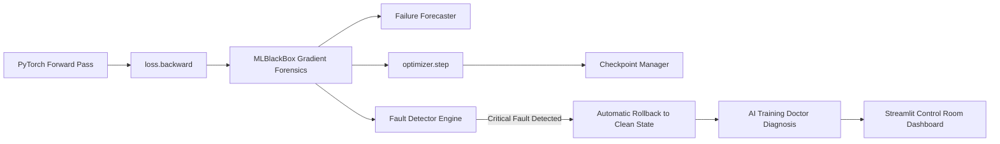

<div align="center">

# 🛡️ MLBlackBox

### The Neural Network Flight Recorder for PyTorch

[](https://www.python.org/)
[](https://pytorch.org/)
[](https://github.com/VanshAt/MLBLACKBOX)
[](LICENSE)
[](https://streamlit.io/)

**Continuous telemetry, early-warning failure forecasting, immediate fault interception, and architecture-safe state rollback.**

[Key Features](#key-features) • [Quickstart](#quickstart) • [Architecture](#architecture) • [Control Room Dashboard](#control-room-dashboard) • [Benchmarks](#benchmarks) • [Documentation](#documentation)

</div>

---

## Why MLBlackBox?

Training deep neural networks is expensive, compute-intensive, and prone to silent failures. Over 80% of training runs suffer from sudden numerical instabilities:
- **Gradient explosions** that blow parameter weights to infinity.
- **Gradient vanishing** that stalls learning for hours without warning.
- **NaN/Inf propagation** caused by boundary violations like $\log(0)$ in custom loss functions.
- **Loss spikes & plateaus** that silently waste thousands of dollars in cloud GPU compute.

Traditional experiment tracking tools observe these failures **passively**. They generate pretty charts of your failed run after the crash, but they cannot intervene.

**MLBlackBox acts like an airplane's flight recorder**:
1. It continuously monitors gradient statistics and weight drifts **before** weights update.
2. It **forecasts impending failures** using rolling z-scores and variance tracking.
3. It **immediately intercepts arithmetic faults** before corrupted weights overwrite memory.
4. It **automatically rolls back** model weights, optimizer momentum, schedulers, and RNG seeds to the last verified clean checkpoint.
5. It runs a **local, 100% offline AI Training Doctor** that diagnoses the root cause and provides copyable PyTorch fixes.

---

## Key Features

- **⚡ Lightweight Telemetry**: Adds less than **0.35 milliseconds** overhead per epoch.
- **🎯 5-Fault Immediate Detection**: Catastrophic Gradient Explosion, Vanishing Gradients, NaN/Inf Arithmetic, Loss Spikes, and Optimization Stagnation.
- **🔮 Statistical Precursor Forecasting**: Early-warning threat detection estimating lead times to failure without training heavy surrogate deep learning models.
- **🛡️ Architecture-Safe Checkpointing**: Checkpoints serialize model weights, optimizer state, scheduler step, and RNG states with architecture signature verification to prevent shape-mismatch crashes.
- **⏪ One-Call State Rollback**: Resume instantly from healthy states with `trainer.resume()` or `trainer.resume_from_last_healthy_checkpoint()`.
- **🩺 Local Offline AI Training Doctor**: Deterministic root-cause analysis citing concrete audit log evidence and offering ranked PyTorch code fixes.
- **🔒 Optional Privacy-Preserving LLM Mode**: OpenAI-compatible LLM layer with strict telemetry sanitization and automatic fallback to local rule-based AI.
- **🎛️ Dark Control Room Console**: Modern Streamlit dashboard with 9 dedicated operational views and report export options (Markdown, CSV, JSON, HTML).

---

## Architecture Overview



For complete system diagrams and data flow details, see [docs/ARCHITECTURE.md](docs/ARCHITECTURE.md).

---

## Installation

```bash
git clone https://github.com/VanshAt/MLBLACKBOX.git
cd MLBLACKBOX
pip install -r requirements.txt
pip install -r requirements_dashboard.txt
```

---

## Quickstart

Integrate MLBlackBox into any PyTorch training loop in seconds:

```python
import torch
import torch.nn as nn
import torch.optim as optim
from training.trainer import Trainer

# 1. Define model, loss, and optimizer
model = nn.Sequential(nn.Linear(10, 32), nn.ReLU(), nn.Linear(32, 2))
optimizer = optim.Adam(model.parameters(), lr=0.001)
loss_fn = nn.CrossEntropyLoss()

# 2. Wrap with MLBlackBox Trainer
trainer = Trainer(
    network=model,
    loss_fn=loss_fn,
    optimizer=optimizer,
    classification=True,
    clip_norm=1.0  # Optional gradient clipping
)

# 3. Train with active flight recording
trainer.train(X_train, y_train, epochs=50)

# 4. If training stops on a fault, resume from clean checkpoint in one call:
# trainer.resume_from_last_healthy_checkpoint(learning_rate=0.0001)
```

---

## Interactive Demos

Explore real-time failure interception and state rollback:

```bash
# 1. Gradient Explosion Demo (Learning rate too high + unscaled features)
python demo_models/demo_explosion.py --fresh

# 2. Gradient Vanishing / Stagnation Demo (Deep saturating Sigmoid layers)
python demo_models/demo_vanishing.py --fresh

# 3. NaN Propagation Demo (Unsafe log(0) in custom loss function)
python demo_models/demo_nan.py --fresh

# 4. Healthy Baseline Training (Iris 500 epochs, 100% accuracy, 0 false alarms)
python tests/test_iris.py
```

---

## Control Room Dashboard

Launch the Streamlit AI Training Control Room:

```bash
streamlit run dashboard/app.py
```

### Dashboard Console Views:
1. **Overview**: Executive dashboard with the Training Health Score Dial (`0-100`), Forecast Risk Card, and convergence curves.
2. **Training Metrics**: Multi-metric comparison view with interactive epoch sliders.
3. **Layer Health**: Per-layer vulnerability matrix and gradient trendlines.
4. **Fault Timeline**: Vertical forensic event log detailing verified halts and causative batch indices.
5. **Checkpoints**: Complete snapshot inventory with one-click rollback triggers and parameter delta diffing.
6. **Run History**: Parent-child recovery lineage tracking.
7. **AI Training Doctor**: Forensic diagnoses, evidence citations, and copyable PyTorch code fixes.
8. **Failure Forecast**: Categorical risk indicators, time-to-failure estimates, and warning signals.
9. **Settings & Reports**: Multi-format report exports (Markdown, CSV, JSON, HTML).

---

## Benchmarks

Measured on a 500-epoch benchmark run on Iris classification:

| Metric | Vanilla PyTorch | MLBlackBox Instrumented | Delta |
| :--- | :--- | :--- | :--- |
| **Pure Compute Latency** | `0.3849s` | `0.5448s` | `+0.32 ms / epoch` |
| **False Positive Faults** | — | **0** | **0.0% False Alarms** |
| **Arithmetic NaN Interception**| Silent Corruption | **Immediate (Batch 50)** | **Clean Rollback** |
| **Explosion Detection** | Diverged to $\infty$ | **Halted at Epoch 3** | **Clean Rollback** |

For the complete benchmark breakdown, see [benchmarks/benchmark_results.md](benchmarks/benchmark_results.md).

---

## Privacy & Safety Guarantees

1. **Zero External Egress by Default**: The local rule-based AI Training Doctor operates 100% offline.
2. **Sanitized Telemetry**: If LLM mode is enabled, model weights, dataset contents, and source code are **strictly omitted** from prompts. Only downsampled numerical metrics are transmitted.
3. **Advisory Intelligence**: Forecasts and AI recommendations are diagnostic hypotheses and **never** autonomously mutate model architectures or hyperparameters.

---

## Documentation

- [System Architecture](docs/ARCHITECTURE.md)
- [Complete Feature Specification](docs/FEATURES.md)
- [AI Training Doctor & Privacy Architecture](docs/AI_TRAINING_DOCTOR.md)
- [Checkpointing & Automated Recovery](docs/CHECKPOINTING_AND_RECOVERY.md)
- [Early-Warning Failure Forecasting](docs/FORECASTING.md)
- [Live Demonstration Scripts](docs/DEMO_SCRIPT.md)
- [Presentation Slide Outline](docs/PRESENTATION.md)
- [Product Roadmap](docs/ROADMAP.md)

---

## Testing

Run the full suite of 24 unit and integration tests:

```bash
python -m unittest discover tests
```

---

## Limitations

- **Single-Node Focus**: Currently optimized for single-process and single-node multi-GPU training. Distributed multi-node (DDP/FSDP) rank coordination is scheduled for v3.5.
- **Dynamic Graph Restructuring**: Models that dynamically add or remove layers across epochs will trigger an architecture mismatch safety alert during checkpoint restore.

---

## License

MLBlackBox is licensed under the [MIT License](LICENSE).
