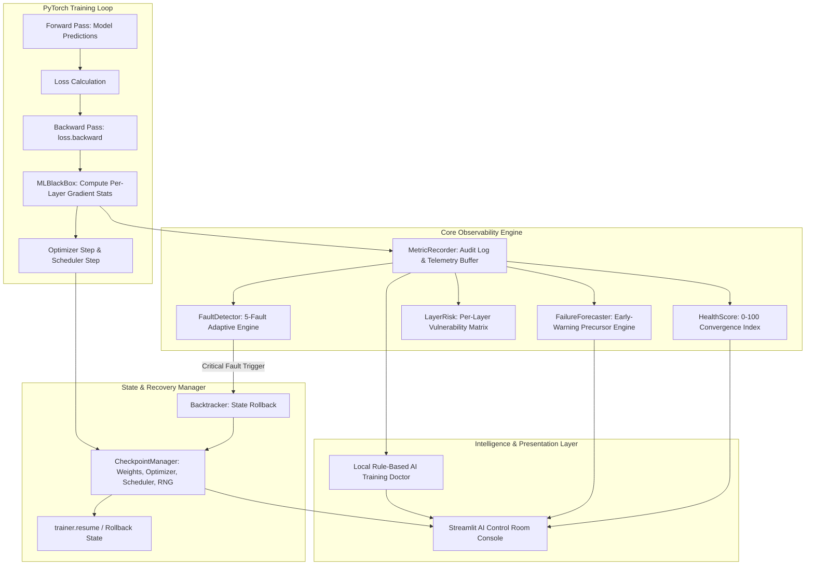

# MLBlackBox Architecture & System Design

MLBlackBox acts as an active **flight recorder** for deep learning training in PyTorch. It continuously captures per-layer gradients, weight drifts, and loss dynamics, preemptively forecasts instabilities, immediately arrests numerical anomalies, and rewinds corrupt state to the last verified healthy checkpoint.

---

## 1. System Topology & Architecture

---

## 2. Module Responsibilities

| Module | Core Responsibility |
| :--- | :--- |
| **`training.trainer.Trainer`** | Wraps the training loop, ensuring gradient statistics are calculated immediately after `backward()` and before `optimizer.step()`. Handles checkpointing, callback triggers, and seamless `resume()`. |
| **`tracker.fault_detector.FaultDetector`** | Stateful multi-fault classifier utilizing adaptive standard deviation thresholds to detect gradient explosion, vanishing, NaN/Inf, loss spikes, and stagnation. |
| **`tracker.checkpoint.CheckpointManager`** | Architecture-validated serialization of model state dict, optimizer state, LR scheduler state, epoch index, and global RNG states (`torch`, `cuda`, `numpy`, `python`). Enforces retention policies and archive import/export. |
| **`tracker.metric_recorder.MetricRecorder`** | In-memory buffer and JSON serializer (`logs/audit_log.json`) recording epoch telemetry, gradient stats, health scores, and early forecasts. |
| **`tracker.health_score`** | Composite convergence scoring function (0–100) evaluating loss stability, gradient variance, learning progress, and checkpoint health. |
| **`tracker.layer_risk`** | Ranks every network layer by failure probability, assigning a risk score, trend status, and recommended remediation. |
| **`ai.failure_forecaster.FailureForecaster`** | Statistical early-warning engine using rolling z-scores and variance tracking to estimate epochs to failure and generate advisory preventive actions. |
| **`ai.training_doctor.LocalTrainingDoctor`** | 100% offline, zero-dependency diagnostic assistant providing structured root-cause explanations and copyable PyTorch code snippets. |
| **`dashboard.app`** | Cyberpunk-themed dark Streamlit Control Room console featuring 9 dedicated operational views. |

---

## 3. Data Flow & Checkpoint Lifecycle

1. **Epoch Initialization**: Training starts or resumes via `trainer.resume()`, linking `run_id` to its parent session in `runs/run_history.json`.
2. **Batch Execution**: On each forward-backward pass, gradients are inspected for NaN/Inf. If numerical overflow occurs, training breaks immediately before parameter divergence.
3. **Pre-Step Gradient Forensics**: Gradient L2 norm, mean, and standard deviation are captured across all named parameter tensors before `optimizer.step()` and `optimizer.zero_grad()`.
4. **End-of-Epoch Evaluation**:
   - `MetricRecorder` records loss, accuracy, and gradient stats.
   - `calculate_health_score` computes the 0–100 health score.
   - `FailureForecaster` computes precursor risks and warning signals.
   - `CheckpointManager` saves a verified snapshot including RNG seeds.
   - `FaultDetector` checks for anomalies. If an anomaly is validated, training halts, the last healthy checkpoint is restored, and the root-cause diagnosis is published.
